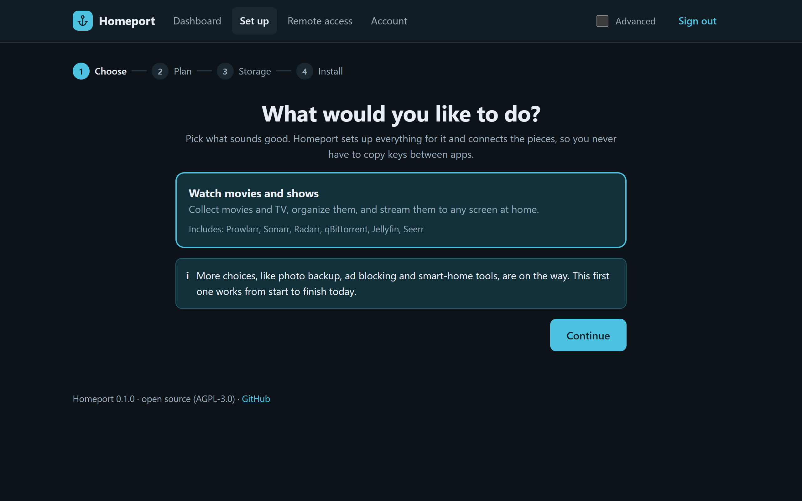
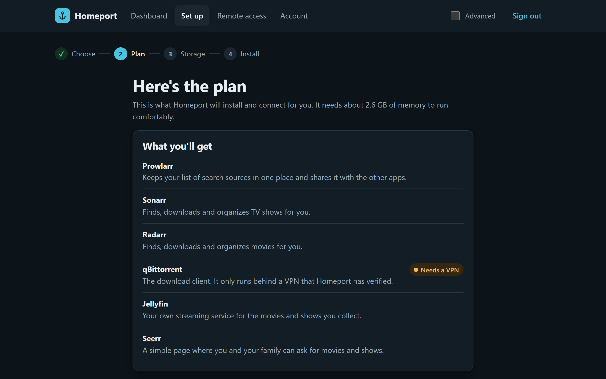
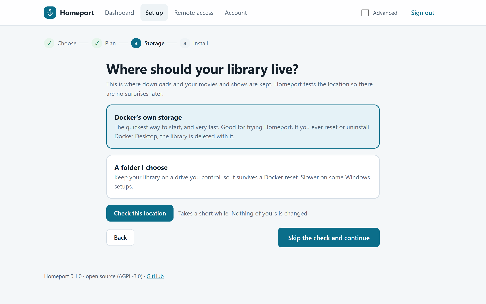
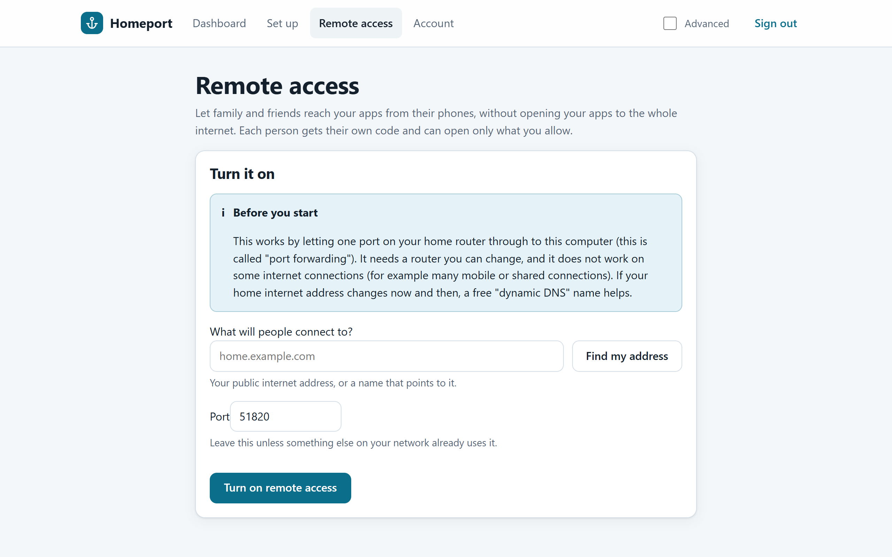
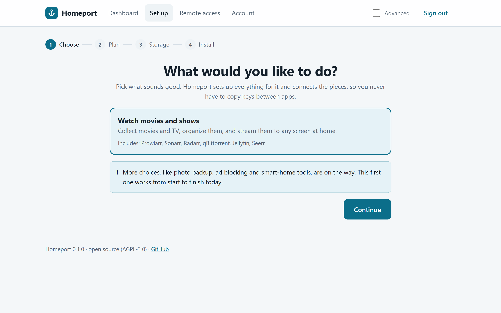
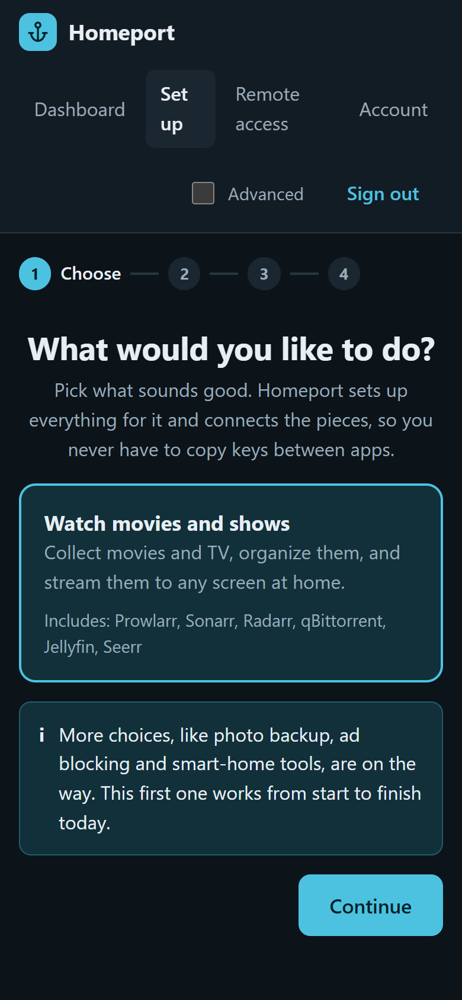

<p align="center"></p>

# Homeport

**One friendly place to roll out your whole media stack and home services, already wired together.**

Homeport takes a complete beginner from "I have Docker Desktop" to a working Sonarr + Radarr + Prowlarr + qBittorrent (behind a VPN) + Jellyfin + Seerr setup, with no YAML and no copying API keys between apps. Advanced users get an Advanced mode and an exportable Compose file.

Homeport is a **standalone product**: it needs no account, no cloud service and no other software besides Docker. The intended experience is described in [`docs/UX.md`](docs/UX.md).

> ## Status: alpha (0.1.0), released as a pre-release.
>
> The app works end to end for **one goal** (watch movies and shows) on **Windows with Docker Desktop**, and its end-to-end tests also pass on Linux (Docker Engine on GitHub's Ubuntu runners): you open a web page, create an account, pick what you want, and Homeport installs and connects everything and shows you a dashboard. The image is published and signed on GitHub's container registry. It has **not had a security review**, so do not expose it to the internet. macOS and real Linux hardware (home servers, NAS boxes, Raspberry Pi) have not been tried. See the [changelog](CHANGELOG.md) for what is in 0.1.0 and its known limitations.

## A look inside

<p align="center">
  
  
</p>
<p align="center">
  
  
</p>
<p align="center">
  
  
</p>

Light and dark themes, and it works on a phone.

## Try it

You need **Docker** (Docker Desktop on Windows or macOS, or Docker Engine with Compose v2 on Linux). The first install downloads several GB of images.

```bash
docker run -d --name homeport --restart unless-stopped --read-only --tmpfs /tmp --cap-drop ALL --security-opt no-new-privileges:true --add-host host.docker.internal:host-gateway -p 127.0.0.1:8484:8484 -v /var/run/docker.sock:/var/run/docker.sock -v homeport-data:/data ghcr.io/click2x/homeport:0.1.0
docker logs homeport
```

Open <http://localhost:8484> and enter the setup code printed in the log (it looks like `K7QM-2XWB-9TDA`) to create your account. Then follow the pages: choose what you want, review the plan, check your storage, install.

- The extra flags are the hardening the tests run with: a read-only file system, no extra Linux capabilities, and no privilege escalation. `--add-host` lets Homeport notice programs on your computer that already use a port (it is needed on plain Linux and harmless elsewhere).
- **It only listens on your own computer** (`127.0.0.1`). The container holds access to Docker, which is root-equivalent, so keep it that way until remote access with proper protection exists.
- Your data lives in the `homeport-data` volume. To start over: `docker rm -f homeport` and `docker volume rm homeport-data` (this does not remove the apps Homeport installed; use `docker compose -p homeport down -v` for those).

### Downloads and the VPN

The download client (qBittorrent) **only starts behind a VPN that Homeport has tested and confirmed works**. During setup you add your VPN provider's details (for WireGuard you paste the file your provider gives you). Until a VPN works, everything else is set up and downloads simply stay off. If the VPN drops later, the gateway's firewall stops the client's traffic rather than letting it leak.

There is deliberately no button to turn this off. If you decide to download without a VPN, you must edit one line in `homeport.toml` by hand (the app shows you how). You are responsible for what you download and for the laws that apply to you.

To build it yourself instead, clone this repository and run `docker build -t homeport .`, then use `homeport` in place of the image name above.

## What works

- **A guided web interface**: first-run account with a one-time setup code, goals, a plain-language plan, VPN setup, a storage check, a live install with progress, and a dashboard with a link and status for every app. Simple and Advanced modes, light and dark themes, works on a phone.
- **Deploys and wires everything** from generated Compose, with API keys Homeport generates itself: root folders, qBittorrent as the download client in Sonarr and Radarr, Prowlarr linked to both, the Jellyfin first-run wizard and libraries, TRaSH quality profiles through Recyclarr, and Seerr signed in through Jellyfin and linked to Sonarr and Radarr. Running it again changes nothing.
- **Picks free ports** automatically when something on your computer already uses an app's usual port.
- **Storage checker** that measures hardlinks, safe file moves, drive speed, permissions and free space, rates the location Best, Good or Compatible, and explains problems in plain words with a fix.
- **VPN gate with a kill switch**, a plain-language VPN check, and the `homeport.toml` override above.
- **Security basics**: scrypt-hashed passwords, hashed session tokens, an anti-forgery header on every change, sign-in lockout, an audit log, secrets encrypted at rest, and no secrets in the exported Compose file.

- **Remote access with WireGuard.** Turn it on, invite people one at a time, and each gets their own QR code (shown once; the key is never stored). A person can open only the apps you choose, through a small gateway address, and nothing else on their phone is routed through your home. You can change someone's apps, give invitations an end date, see who is connected, and revoke anyone instantly without disturbing the others. Tested with real WireGuard clients, including a client file edited to try to reach more.

All of that is covered by 223 automated tests plus end-to-end scripts that run the real image against real Docker (`npm run e2e:server`).

## What does not work yet

- **Remote access has only been tested on one computer**, with WireGuard clients on the same Docker network, not with a real phone through a real router. It needs a router you can forward a UDP port on, and it will not work behind carrier-grade NAT (common on mobile and some shared connections). The Tailscale alternative and automatic router port opening are not built.
- **Only one goal.** Photo backup, ad blocking, smart home and other services are planned as community-extensible manifests.
- **Platforms.** Docker Desktop for Windows is the platform it is built and used on. The full end-to-end suite also passes on Docker Engine on Ubuntu in GitHub Actions, which shows the approach works on Linux, but nobody has run it on real Linux hardware yet. macOS is untested.
- **No security review yet**, and the container runs as root with the Docker socket.
- A connected VPN tunnel has only been tested against a real ProtonVPN WireGuard account in the original proof of concept, not through the new interface.
- Recyclarr uses a minimal profile config. Indexers are not configured; you add your own.
- Not yet checked by the storage checker: whether files added from outside Docker are noticed, and whether a drive is mounted.

## Roadmap to a first release

1. Test remote access with a real phone and router, and add the Tailscale alternative for connections that cannot forward a port.
2. Keep the pinned app versions current with tested updates (the nightly end-to-end run watches for breakage).
3. A security review and hardening (non-root, narrower Docker access).
4. Linux and macOS testing.
5. More goals and services as community manifests.

Design notes: [`docs/DESIGN.md`](docs/DESIGN.md). Experience notes: [`docs/UX.md`](docs/UX.md).

## Development

A TypeScript monorepo under [`packages/`](packages/):

| Package | What it holds |
|---|---|
| `@homeport/core` | The app manifest schema, the catalog of services (`manifests/*.yaml`) and the goals that select them |
| `@homeport/engine` | Turns a plan into a Docker Compose project (storage modes, VPN routing, generated-key placeholders) and runs the Docker side: deploy, storage checker and tiers, the VPN gate and kill-switch check, `homeport.toml`, Recyclarr |
| `@homeport/connectors` | Typed, idempotent wiring for Sonarr, Radarr, Prowlarr, qBittorrent, Jellyfin and Seerr |
| `@homeport/server` | The API: account setup, sign-in, encrypted secrets, the deploy job with live progress, VPN and storage endpoints, and it serves the web interface |
| `@homeport/web` | The web interface (React, Vite, plain CSS with light and dark themes) |

```bash
npm install
npm test           # unit and interface tests, no Docker needed
npm run typecheck  # TypeScript for every package
npm run lint       # Biome
npm run build      # compile everything, including the web interface
npm run e2e        # deploys a real stack, wires it, wires it again, tears it down (needs Docker; downloads images)
npm run e2e:vpn    # proves the download client has no internet when its VPN is down (needs Docker)
npm run e2e:server # builds the image and drives the whole app through its API on real Docker
npm run e2e:wireguard # real WireGuard clients against the real sidecar: scoping, revoking, restart (needs Docker)
```

A manifest is a short YAML file, so adding a service to the catalog needs no code.

## More

[Changelog](CHANGELOG.md) · [Contributing](CONTRIBUTING.md) · [Security policy](SECURITY.md) · [Design notes](docs/DESIGN.md) · [Experience notes](docs/UX.md)

## Ground rules

- Homeport does **not** bundle or recommend indexers or content sources. You are responsible for what you download and for following the laws that apply to you.
- The container holds access to the Docker socket, which is root-equivalent. Treat access to Homeport as access to your computer.
- **Outside calls.** Besides pulling images, the only thing Homeport contacts on its own is a public-address lookup (`api.ipify.org`) during the VPN check, to confirm your downloads do not leave from your home address. No telemetry.

## Tested with

App images are **pinned to exact digests** in [`packages/core/manifests`](packages/core/manifests), so every install gets the versions that were tested: Prowlarr 2.6.5.5623, Sonarr 4.0.20.3014, Radarr 6.4.4.10685, qBittorrent 5.3.0, Jellyfin 12.3.0, Seerr 3.5.1, Recyclarr 8.8.0 and gluetun (the 2026-10-19 build), on Docker Desktop 29 for Windows (and Docker Engine on Ubuntu in CI). Updating them is a deliberate, tested change.

## The original proof of concept

[`spike/`](spike/) is the headless script this project started from. It still works (`cd spike && node wire.mjs up`) and is kept for reference. See [`spike/example.env`](spike/example.env) for its options. The app above supersedes it.

## License

[GNU AGPL-3.0](LICENSE). If you run a modified version of Homeport as a network service, you must offer its source to the users of that service.
